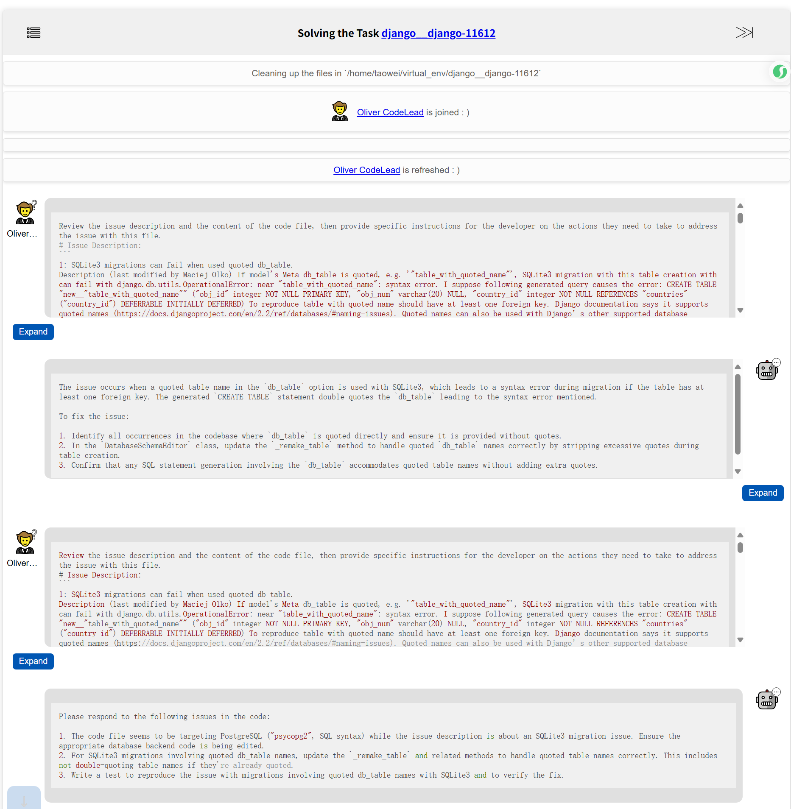

Note that most experiments were conducted in February 2024, and the state of [SWE-bench at that time](https://github.com/SWE-bench/SWE-bench/tree/b93ac87) may differ from the current version.

## Download Data & Config

1. Download each GitHub repository (repo) in `SWE-bench` to `$HOME/SWE-bench-repo`

> All of these repos are downloaded from [https://github.com/swe-bench](https://github.com/swe-bench) such as [https://github.com/swe-bench/django__django](https://github.com/swe-bench/django__django)

```bash
cd $HOME
mkdir SWE-bench-repo
cd SWE-bench-repo
git clone git@github.com:swe-bench/astropy__astropy.git
git clone git@github.com:swe-bench/django__django.git
git clone git@github.com:swe-bench/matplotlib__matplotlib.git
git clone git@github.com:swe-bench/mwaskom__seaborn.git
git clone git@github.com:swe-bench/pallets__flask.git
git clone git@github.com:swe-bench/psf__requests.git
git clone git@github.com:swe-bench/pydata__xarray.git
git clone git@github.com:swe-bench/pylint-dev__pylint.git
git clone git@github.com:swe-bench/pytest-dev__pytest.git
git clone git@github.com:swe-bench/scikit-learn__scikit-learn.git
git clone git@github.com:swe-bench/sphinx-doc__sphinx.git
git clone git@github.com:swe-bench/sympy__sympy.git
```

If you save these repos in different path, please edit [config.py](../../config.py)

2. Download `swe-bench.json` from [Google Drive](https://drive.google.com/uc?export=download&id=164g55i3_B78F6EphCZGtgSrd2GneFyRM) to the path mentiond as `--swe_bench_tasks` in [exp.py](../../exp.py)

> Ref: [Argument --swe_bench_tasks is unclear](https://github.com/SWE-bench/SWE-bench/issues/39); [wget/curl large file from google drive](https://stackoverflow.com/questions/25010369/wget-curl-large-file-from-google-drive)

3. Config your API token

Please edit [config.py](../../config.py).

If you want to use a different LLM, please edit the function `request_api` in [chat_with_LLM.py](chat_with_LLM.py).

## Run Redis Server for Caching

```bash
redis-server --daemonize yes
```

## Visualize the Process of Multi-Agent

```bash
cd visual_web_page/
python process.py
```

You can now open the webpage to view the visualization, as shown below:




## Main Experiments

Run `exp.py`, for example,

```bash
python exp.py --model_name gpt-4-0613 --end_idx 10 --version 240201
```
